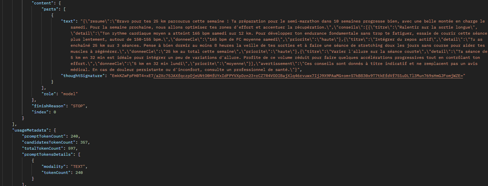
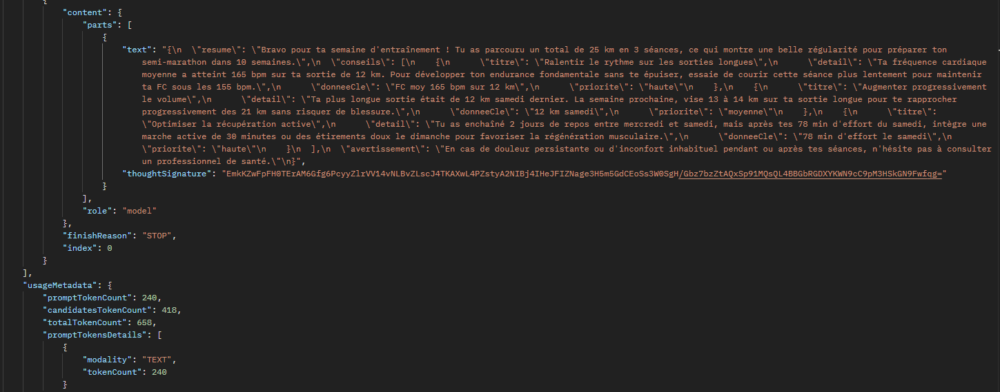
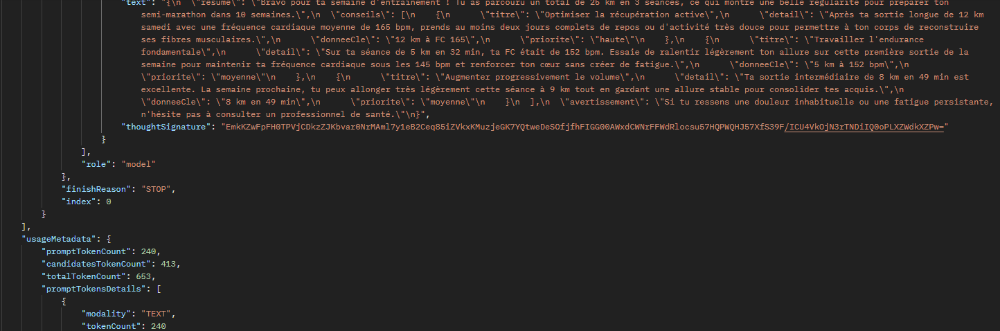
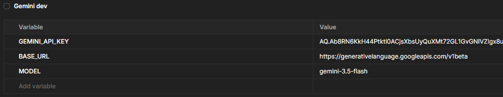
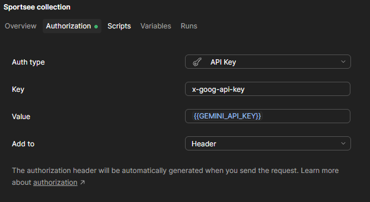

# Découverte de l'API Gemini

## 1. Fonctionnement

- Endpoint : `POST https://generativelanguage.googleapis.com/v1beta/models/{MODEL}:generateContent`
- Authentification : header `x-goog-api-key`
- Corps : `system_instruction` (consignes), `contents` (messages), `generationConfig` (paramètres)
- Réponse : texte dans `candidates[0].content.parts[0].text`, tokens dans `usageMetadata`
- Aucune mémoire entre deux appels : l'historique d'une conversation doit être renvoyé à chaque message.

Fonctionnalités utiles : `system_instruction` (rôle et règles du coach), `responseSchema` (JSON au format imposé), `GET /models` (modèles et limites), `countTokens` (taille d'un prompt), `thinkingConfig` (réflexion interne).

## 2. Paramètres

- `temperature` : variabilité des réponses.
- `maxOutputTokens` : longueur maximale, réflexion comprise.
- `thinkingLevel` : réflexion interne, jusqu'à 66 % des tokens d'un appel (951 sur 1 446).

| Critère | T = 0 | T = 1 | T = 2 |
|---|---|---|---|
| JSON conforme | Oui | Oui | Oui |
| Fidélité aux données | Oui | Non : « bonne progression » sans historique, « pas de repos après la sortie longue » | Oui |
| Prudence (12 km, limite +10 %) | Oui : 13 km (+8 %) | Non : 14 km (+17 %) | Partiel : 13 à 14 km |

La température 0 donne les réponses les plus fidèles (un seul essai par valeur, à confirmer).

## 3. Limites

- Contexte : 1 048 576 tokens en entrée, 65 536 en sortie.
- Coût : facturé par token, réflexion comprise.
- Palier gratuit : quotas par minute et par jour (429), surcharges fréquentes (503).
- Modèles retirés régulièrement (`gemini-2.5-flash` refusé aux nouveaux comptes : 404).
- Réponses non déterministes, inventions possibles.

## 4. Sécurité et confidentialité

- Clé API en variable d'environnement, jamais côté front ni dans les captures.
- En gratuit, Google peut réutiliser les requêtes.
- Fréquence cardiaque = donnée de santé possible (RGPD) : envoyer le minimum, sans identifiant.

## 5. Collection Postman

Environnement `Gemini - Dev` (`GEMINI_API_KEY` en secret, *current value* uniquement, `BASE_URL`, `MODEL`). Authentification définie sur la collection, héritée par toutes les requêtes.

