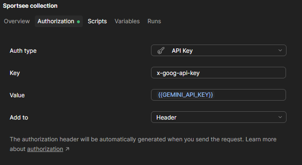
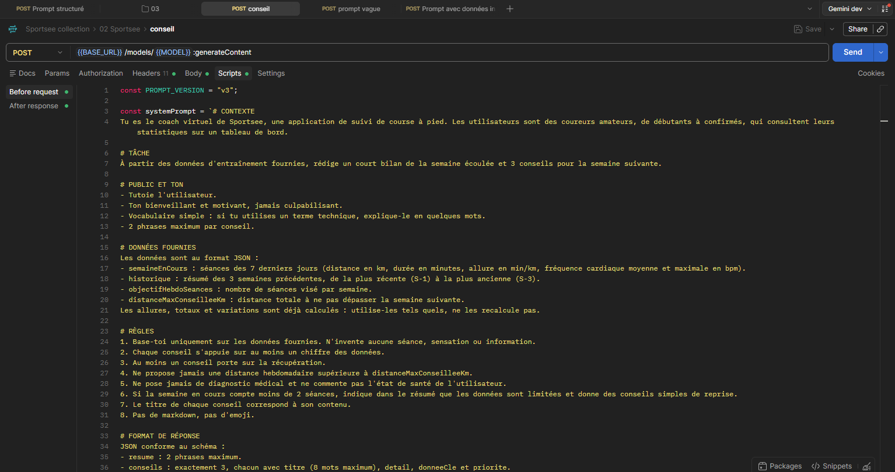
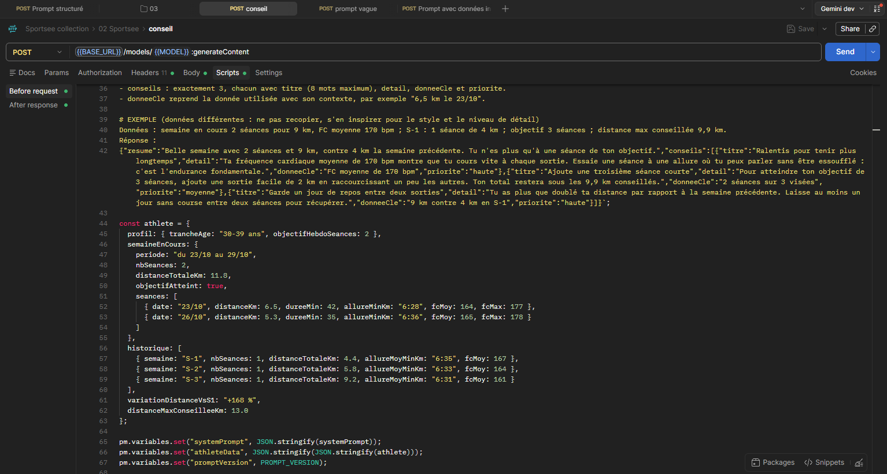
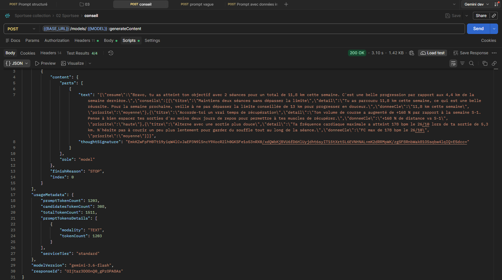
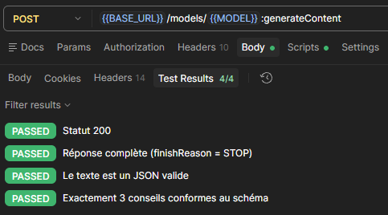
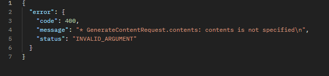
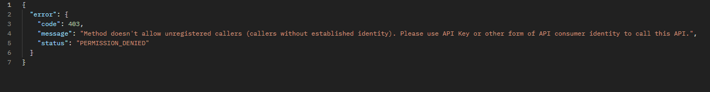
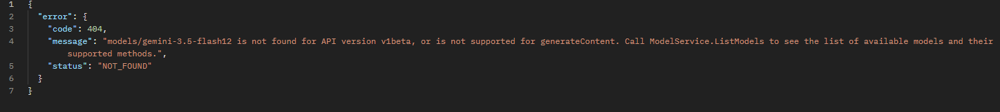

# Requête de génération de conseils

## 1. Architecture

`Front React → Backend Sportsee → API Gemini`

Le backend récupère les séances, construit la requête, vérifie la réponse et la renvoie au front. La clé API ne quitte jamais le serveur.

## 2. Endpoint et headers

- `POST {{BASE_URL}}/models/{{MODEL}}:generateContent`
- `x-goog-api-key: {{GEMINI_API_KEY}}` (définie sur la collection)
- `Content-Type: application/json`
- Modèle configurable : un modèle a été retiré pendant les tests.



## 3. Modèle de body

Le prompt et les données sont injectés par le script _Pre-request_ (dans l'application : par le backend).

```json
{
  "system_instruction": { "parts": [{ "text": {{systemPrompt}} }] },
  "contents": [{
    "role": "user",
    "parts": [
      { "text": "Voici mes données d'entraînement. Que me conseilles-tu pour la semaine prochaine ?" },
      { "text": {{athleteData}} }
    ]
  }],
  "generationConfig": {
    "temperature": 0,
    "maxOutputTokens": 2048,
    "thinkingConfig": { "thinkingLevel": "low" },
    "responseMimeType": "application/json",
    "responseSchema": {
      "type": "OBJECT",
      "properties": {
        "resume": { "type": "STRING" },
        "conseils": {
          "type": "ARRAY",
          "items": {
            "type": "OBJECT",
            "properties": {
              "titre": { "type": "STRING" },
              "detail": { "type": "STRING" },
              "donneeCle": { "type": "STRING" },
              "priorite": { "type": "STRING", "enum": ["haute", "moyenne", "basse"] }
            },
            "required": ["titre", "detail", "donneeCle", "priorite"]
          }
        }
      },
      "required": ["resume", "conseils"]
    }
  }
}
```

Température 0 pour la fidélité, `maxOutputTokens` et `thinkingLevel` pour plafonner le coût, schéma pour une réponse directement affichable.




## 4. Réponse

Le JSON des conseils est dans `candidates[0].content.parts[0].text`. Le script _Post-response_ vérifie le statut 200, `finishReason = STOP`, la validité du JSON et la présence de 3 conseils complets. L'application ajoute ensuite un avertissement médical fixe.




## 5. Erreurs

| Code | Cause         | Réaction                                 |
| ---- | ------------- | ---------------------------------------- |
| 400  | Body invalide | Mettre dans les logs                     |
| 403  | Clé invalide  | Alerter                                  |
| 404  | Modèle retiré | Modèle de secours                        |
| 429  | Quota dépassé | Réessayer, sinon conseils en cache       |
| 503  | Surcharge     | 3 essais espacés, puis modèle de secours |

L'utilisateur voit un message simple, jamais l'erreur brute.





## 6. Coûts, limites et sécurité

- 3 générations par jour et par utilisateur, cache tant que les séances n'ont pas changé.
- Génération au clic, bouton désactivé pendant le chargement.
- Alerte de budget et plafond de quota sur le projet Google Cloud.
- Requête d'environ 1 200 tokens, très en dessous de la limite de contexte.
- Clé côté serveur uniquement, et absente de la collection exportée.
